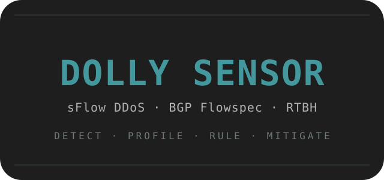

<div align="center">



[](https://github.com/tcpsheep/Dolly-Sensor/releases/latest)


</div>

# Dolly Sensor

**Open-source sFlow DDoS detection and mitigation controller with a persistent BGP Flowspec/RTBH rules engine, written in Go.**

Dolly Sensor is a self-contained DDoS detection and mitigation system for network
operators. It listens for sampled traffic, builds behavioral profiles of every protected
destination and external source, detects attacks from a combination of deterministic
checks and statistical evidence, and — when armed — enforces decisions as BGP Flowspec or
RTBH announcements to your edge router.

It is written entirely against the Go standard library: no external modules, no build
step for the dashboard, no database. One binary ingests, detects, decides, and serves
the UI. A second binary generates synthetic sFlow for lab use.

> **What makes it different:** a dependency-free supply chain (standard library only),
> per-source reputation that is learned and survives restarts, and a real rules engine
> where standing policy is re-announced after every restart, configuration change and
> BGP session re-establishment.

## At a glance

| | |
|---|---|
| **Category** | Out-of-band, flow-based DDoS detection and mitigation |
| **Telemetry** | sFlow v5 over UDP |
| **Detection** | Blocklists, TCP state, FTP abuse, source reputation, volumetric scoring, warm-up and trust |
| **Mitigation** | BGP Flowspec (RFC 8955/8956) and RTBH (RFC 3882), IPv4 |
| **Policy** | Persistent rules engine: standing and conditional rules, dashboard editor, JSON API |
| **Dependencies** | Go standard library only — no modules, no database, no JS toolchain |
| **Runtime** | Single static binary with embedded dashboard (`dollysensor`), plus `sflowgen` for labs |
| **License** | MIT |

## Why another DDoS sensor?

Most open-source flow-based mitigators are either threshold blackholers — detect a big
host, announce a /32 — or thin control planes over a third-party BGP daemon. Dolly Sensor
was built around a different question: *what does the operator know about this network
that a threshold cannot?* That question is the rules engine, and it is a first-class part
of the product rather than a configuration file.

| Project | Language | Flow input | Mitigation | Policy surface | Runtime dependencies | License |
|---|---|---|---|---|---|---|
| **Dolly Sensor** | Go | sFlow v5 | Flowspec + RTBH | Persistent rules engine (standing/conditional), dashboard + JSON API | None — stdlib only | MIT |
| [FastNetMon](https://github.com/pavel-odintsov/fastnetmon) | C++ | sFlow, NetFlow, IPFIX, SPAN | BGP blackhole; Flowspec in commercial editions | Per-hostgroup thresholds, scripts, API; web UI in commercial editions | Boost and other C++ libraries, external BGP tooling | GPL-2.0 |
| [Kapkan](https://github.com/fornex/kapkan) | Go | sFlow, NetFlow, IPFIX | RTBH, Flowspec, XDP drops, scrubbing | Config-driven hostgroups, escalation ladders, embedded console | goflow2, GoBGP (vendored) | Apache-2.0 |
| [NetDeflect](https://github.com/0vm/NetDeflect) | Python | sFlow/NetFlow in its advanced tier | nftables/XDP, BGP in its advanced tier | Attack signatures and settings file, chat alerts | Python, nftables | Apache-2.0 |
| [sFlow-RT ddos-protect](https://github.com/sflow-rt/ddos-protect) | JavaScript | sFlow | RTBH + Flowspec | sFlow-RT app with the sFlow-RT UI | Java sFlow-RT + InfluxDB | MIT |
| [prefixd](https://github.com/lance0/prefixd) | Rust | None — API-driven | Flowspec | Policy daemon; needs an external detector | None | MIT |

*Landscape as of October 2026; corrections are welcome as an issue.*

**Choose Dolly Sensor when** you want one dependency-free binary you can read end to end,
sFlow is already exported from your edge, and you need per-partner trust with permanent
policy (never block the monitoring range, always rate-limit that scanner block) rather
than a pure volume threshold.

**Choose something else when** you need NetFlow/IPFIX ingestion, IPv6 mitigation,
in-kernel XDP drops, inline scrubbing, or multi-tenant management today.

## Contents

- [What it does](#what-it-does)
- [Profiling](#profiling)
- [Rules](#rules)
- [Automatic detection](#automatic-detection)
- [Build and run](#build-and-run)
- [Safety defaults](#safety-defaults)
- [Configuration](#configuration)
- [Dashboard](#dashboard)
- [Tests](#tests)
- [FAQ](#faq)
- [Glossary](#glossary)
- [Troubleshooting](#troubleshooting)
- [Scope](#scope)

## What it does

1. **Ingest** sFlow v5 datagrams over UDP, decode the sampled packets, and estimate
   real packet and byte counts from the sampling rate.
2. **Profile** every protected destination and every external source — recent rates,
   long-term baselines, protocol mix, TCP session behavior, and trust earned through
   completed handshakes and long-lived sessions.
3. **Detect** attacks by layering deterministic checks (blocklists, out-of-state TCP,
   FTP abuse), behavioral reputation, and statistical volume evidence into a single
   explainable score.
4. **Decide** with guardrails: only explicitly protected prefixes can ever be the
   target, default routes are refused, internal sources are never blocked, and every
   action is bounded, deduplicated, and temporary unless it comes from a standing rule.
5. **Enforce** as BGP Flowspec header matches (protocol, ports, TCP flags, packet
   length, fragmentation, prefixes, ranges) or RTBH for a confirmed extreme single
   source, then withdraw automatically on expiry, rule change, or shutdown.
6. **Operate** through a live dashboard: traffic, evidence, alerts, actions, learned
   intelligence, and a full rules engine with an editor, preview, and drag-and-drop
   ordering.

## Profiling

The sensor never judges a packet in isolation; it judges it against what it has
learned about the destination and the source.

**Per destination** it maintains recent rate windows (packets, bytes, per-protocol and
per-port splits), a long-term baseline used to compute deviation, top sources, session
counts, and warm-up state. A brand-new destination starts in a *learning* phase with a
capped score so the first few packets cannot trigger mitigation on their own.

**Per source** it maintains reputation. Sources that complete TCP handshakes and hold
long-lived sessions earn trust; sources that send SYNs which never complete handshakes
lose it. Trust never hides traffic — it raises the evidence required to act against
that source, and it decays over time so it must be re-earned.

**Profiles survive restarts.** Destination profiles, source reputations, and manual
trust decisions are persisted atomically, so a restart does not reset months of learned
behavior. Recent packets, alerts, and short-window baselines are in-memory only and
start fresh.

Sampling is honored throughout: every observation carries the estimated real packet
and byte counts implied by the sFlow sampling rate, and all rate and window math uses
those estimates. The dashboard can therefore show millions of estimated packets while
the inspector holds only the sampled observations behind them.

## Rules

The rules engine is the operator-facing half of the sensor. Automatic detection
decides what *looks like* an attack; rules encode what *you know* about your network:
which partners must never be blocked, which scanner ranges should be permanently
rate-limited, which payload signatures are a page on your application, and how
aggressive to be about distributed scans.

Rules are persisted to a JSON file, written atomically, survive restarts, and are
managed from the dashboard (create, edit, enable/disable, delete, preview, and
drag-and-drop reordering) or through a JSON API. The order is the evaluation order:
rules run top to bottom, and the sequence is part of the persisted state.

### Standing vs conditional

Every rule is one of two modes:

**Standing** rules are always active. The rule's header match is announced as a BGP
Flowspec action immediately, and re-announced after every restart, configuration
mutation, and BGP session re-establishment. Disabling or deleting the rule withdraws
its action. Standing rules are the tool for permanent policy: "always rate-limit this
scanner range toward SSH", "never touch traffic from our monitoring partner".

**Conditional** rules watch traffic and act only when their condition fires. They
produce temporary, rule-owned actions that expire on their own. Conditions make them
the tool for things automatic detection cannot know: "if anyone requests `/admin` in
their first packets, discard that conversation", "if more than ten distinct sources
probe this prefix within five seconds, rate-limit the destination".

### Header matching

The match section selects which traffic a rule sees and, for rule-scoped enforcement,
exactly what Flowspec announces:

| Field | Exact | Range | Notes |
|---|---|---|---|
| Destination prefix | — | — | Required; must sit fully inside a protected CIDR |
| Source prefix | — | — | Optional; refused if it overlaps protected space |
| Protocol | ✓ | — | 0 = any; ports and TCP flags require TCP/UDP |
| Source port | ✓ | ✓ min–max | Exact and range are mutually exclusive |
| Destination port | ✓ | ✓ min–max | Exact and range are mutually exclusive |
| TCP flags | bitmask | — | All selected bits must be set; TCP only |
| Packet length (bytes) | ✓ | ✓ min–max | e.g. 64–256 to match small-packet floods |
| Fragmented only | ✓ | — | Matches fragmented packets only |
| Direction | ✓ | — | any / inbound / internal |

Ranges are inclusive and one side may stay open: a minimum alone means "≥ min", a
maximum alone means "≤ max". On the wire, ranges are encoded as RFC 8955 GE/LE
comparison operators chained with the AND bit, so a real router evaluates them as a
proper interval. Setting both an exact value and a range on the same field is rejected
at validation, as is a port range on a non-TCP/UDP protocol.

### Conditions (conditional rules only)

Conditions are evaluated over a sliding window of sampled observations:

- **`min_pps` / `min_bps`** — estimated packets or bits per second inside the window.
- **`min_packets` / `min_bytes`** — estimated totals inside the window.
- **`min_sources`** — number of *distinct source addresses* seen in the window. This is
  the distributed-attack guard: a SYN flood from one host and a slow scan from five
  hundred hosts look nothing alike to it. It requires an empty source prefix in the
  match (a pinned source would make counting distinct sources meaningless).
- **`consecutive`** — how many windows in a row the threshold must hold before the
  rule fires (1–60). Raises confidence at the cost of reaction time.
- **`cooldown_seconds`** — after firing, how long the rule stays quiet before it can
  fire again.
- **`window_seconds`** — the evaluation window (1–60s).

### Payload conditions

Payload conditions inspect the captured payload of sampled packets — up to the capture
budget (512 bytes), which is itself bounded by whatever your exporters actually
include in each sample record:

- **`contains`** — a pattern must appear in the payload (after an optional byte
  `offset`). The pattern can be text or hex, matched as contains / prefix / suffix,
  or as a regular expression (text only). Case-insensitive matching is available for
  text.
- **`present_first_n`** — the pattern must appear within the first N *sampled* packets
  of a flow. Useful for "the first bytes of any legitimate client say X".
- **`absent_first_n`** — the pattern must NOT appear in the first N sampled packets of
  a flow. Useful for "anyone whose first packets don't complete a handshake".

First-N modes count sampled observations, not every packet on the wire, and cannot be
combined with volume or distinct-source thresholds on the same rule.

**Honesty about enforcement:** payload and first-N conditions are evaluated on the
sampled stream, but Dolly cannot announce a payload match to a router. When such a
rule fires, enforcement is the resulting *header* match — by default scoped to the
exact observed conversation (flow scope), so the discard or rate-limit lands on the
flow that carried the payload, not on the whole prefix. Exact inline payload
enforcement would require a data-plane element, which is outside this sensor's
architecture.

### Actions

- **`allow`** — a local bypass. Matching traffic is exempt from *Dolly's automatic*
  mitigation. It is never announced as a BGP permit and cannot override network
  policy; a router rule still applies. Standing only — a conditional allow has no
  meaningful enforcement and is rejected.
- **`discard`** — announce a Flowspec discard. A rule-scoped discard requires a source
  prefix unless `rules.allow_destination_discard` is explicitly enabled, because
  discarding *all* traffic to a protected destination is almost never what you want.
- **`rate-limit`** — announce a Flowspec traffic-rate action with an explicit BPS cap,
  falling back to `mitigation.rate_limit_mbps` when unset.

Each action carries a duration (temporary rules) and an enforcement scope: **rule**
(the rule's own header match) or **flow** (narrowed to the specific observed
conversation that triggered it). Volume conditions default to rule scope; payload
conditions default to flow scope.

### Guardrails

The same safety checks that govern automatic mitigation govern rules:

- The destination must be fully inside an explicitly protected prefix. There is no
  "protect everything" rule.
- Default routes are refused as match or enforcement targets.
- A source prefix overlapping protected space is refused.
- Conditional allow is rejected outright.
- Rule actions draw from a dedicated capacity pool (`rules.max_rules`) separate from
  the automatic pool, so a large ruleset cannot starve automatic detection responses.
- Every standing action is reconciled: applied at startup, re-announced on BGP
  reconnect, withdrawn when its rule is disabled, deleted, or changed to a different
  match.

### The Rules dashboard view

The dashboard's **Rules** page is the primary interface: KPI summary, the full catalog
in evaluation order with per-rule live state (enforcing / watching / cooldown /
bypassing / error), and an editor covering every field above with mode-aware
enablement — payload fields only unlock in conditional mode, TCP flags only for TCP,
ranges mutually exclusive with exact values. **Preview** runs a draft rule against the
recent sample ring and reports matched observations, flows, potential triggers, and
estimated rates before you commit. Rows can be reordered by dragging or with explicit
up/down buttons; the order persists.

### Rules API

Everything the dashboard does is a JSON API (mutations require the `X-Dolly-Request`
header):

```
GET    /api/rules                 catalog, summary, limits, persistence state
POST   /api/rules                 create (body: full rule)
POST   /api/rules/preview         evaluate a draft against recent samples
PUT    /api/rules/order           set the full evaluation order (body: {order: [ids]})
POST   /api/rules/{id}/move       move one rule to a zero-based position
PUT    /api/rules/{id}            replace a rule
PATCH  /api/rules/{id}/enabled    enable or disable
DELETE /api/rules/{id}            delete and withdraw its actions
```

## Automatic detection

Rules sit beside automatic detection, not in front of it. The detection funnel is
layered so that the cheapest, most certain checks run first:

- **Blocklist** hits are deterministic and immediately critical.
- **TCP state** distinguishes handshakes, established sessions, and out-of-state
  traffic; session state is updated before a packet is judged, and server replies
  from a privileged port are not treated as client abuse.
- **FTP** rules examine control/data direction, command size, and rate.
- **Reputation** from the profiling layer penalizes SYN-heavy sources and rewards
  completed handshakes and long sessions.
- **Volumetric** scoring combines absolute floors, deviation from the destination's
  baseline, tiny-packet share, protocol/SYN concentration, source concentration,
  out-of-state rate, and trust into a single score.
- **Decision** suppresses internal-source actions, requires stronger evidence for
  trusted sources, respects cooldowns, and deduplicates equivalent actions.

An **allow rule overrides this entire pipeline for matching traffic** — that is its
purpose. A conditional rule supplements it with knowledge detection cannot infer.

## Build and run

Requirements: Go 1.23 or newer.

```bash
go build -o dollysensor ./cmd/dollysensor
go build -o sflowgen ./cmd/sflowgen
go test -race ./...
```

Create a local configuration, validate it, and launch:

```bash
cp config.example.json config.json
./dollysensor -check -config config.json
./dollysensor -config config.json
```

The dashboard serves on `http://127.0.0.1:8080`. To print the full default
configuration: `./dollysensor -default-config`.

| Flag | Meaning |
|---|---|
| `-config PATH` | JSON configuration file (default `config.json`) |
| `-check` | Validate configuration and exit |
| `-version` | Print the version and exit |
| `-default-config` | Print a starter configuration and exit |

The bundled `sflowgen` sends synthetic sFlow v5 datagrams (see `sflowgen -help` for
the full flag list) for exercising the collector, detection, dashboard, and simulated
mitigation path in a lab without a router.

> See **[OPERATOR-TUTORIAL.md](OPERATOR-TUTORIAL.md)** for a step-by-step guide to
> collecting real sFlow, dry-running BGP announcements against a lab peer, arming
> automatic mitigation on a production edge, and adding standing/conditional rules.

## Safety defaults

The safe defaults are intentional:

- BGP is **disabled**. Intended actions are built, recorded, and shown as `simulated`.
- The dashboard binds to `127.0.0.1:8080`.
- `protected_cidrs` must contain at least one explicit prefix. There is no "protect
  everything" mode.
- Default routes are refused as mitigation targets. RTBH never targets a protected
  source; destination-only Flowspec discard is refused.
- Mitigations are temporary and are withdrawn on expiry and graceful shutdown.
- No trusted sources are configured unless the operator adds them.
- `mitigation.auto_block` is disabled in the example configuration.

Do not enable BGP and automatic blocking until the simulation output has been reviewed
against a lab peer or canary prefix.

## Configuration

Durations use Go duration syntax (`30s`, `1m`, `1h30m`). Relative file paths resolve
from the process working directory. Unknown JSON fields, malformed durations, invalid
CIDRs, unsafe BGP settings, and empty protected sets are rejected at startup.

### Ownership and trust

- `protected_cidrs` — the only destinations analyzed as attack targets. Required.
- `trusted_sources` — IPs or CIDRs granted additional patience. Trust raises the
  evidence bar; it never hides traffic.

### Detection

`detection.sensitivity` selects the score threshold and persistence window:

| Preset | Threshold | Consecutive windows |
|---|---:|---:|
| `relaxed` | 85 | 8 |
| `balanced` | 70 | 5 |
| `aggressive` | 55 | 3 |
| `ultra` | 40 | 2 |
| `instant` | 25 | 1 |

`detection.network_type` selects the absolute floors that avoid reacting to noise:

| Network | PPS floor | BPS floor |
|---|---:|---:|
| `home` | 2,000 | 20 Mbps |
| `office` | 10,000 | 100 Mbps |
| `datacenter` | 50,000 | 1 Gbps |

`*_override` fields replace preset values when greater than zero. `warmup_windows`
controls how long a new destination stays in the learning phase with a capped score.
`cooldown` suppresses repeated alert attention — not evaluation, and not an active
mitigation.

### Rules

```json
"rules": {
  "enabled": true,
  "file": "./data/rules.json",
  "max_rules": 128,
  "max_flows_per_rule": 8192,
  "evaluation_queue": 4096,
  "allow_destination_discard": false
}
```

- `enabled` — master switch. When disabled, definitions remain visible and editable
  in the dashboard but nothing is evaluated or enforced.
- `file` — persistence path; written atomically on every mutation.
- `max_rules` — hard cap on catalog size and on the rule-action capacity pool.
- `max_flows_per_rule` — bound on per-rule first-N flow tracking.
- `evaluation_queue` — bounded queue between ingestion and rule evaluation; overflow
  is counted, never blocking the collector.
- `allow_destination_discard` — explicit opt-in for rule-scoped destination-only
  discards.

### Mitigation and BGP

`mitigation.auto_block` permits blocklist hits to become actions. Flowspec handles
precise matches and destination-oriented rate limits; RTBH is reserved for a
confirmed, extreme single-source SYN flood from an external host.

To arm announcements, configure at least:

```json
"bgp": {
  "enabled": true,
  "local_as": 64512,
  "peer_as": 64512,
  "peer_ip": "192.0.2.1",
  "peer_port": 179,
  "local_addr": "192.0.2.2",
  "community": "65535:666",
  "next_hop": "192.0.2.2",
  "router_id": "192.0.2.2",
  "hold_time": "90s",
  "connect_timeout": "5s"
}
```

The sensor is the active TCP side and connects to the peer's BGP port. The edge must
accept IPv4 Flowspec and/or IPv4 unicast RTBH and interpret the configured blackhole
community. The sensor never announces a default route.

With BGP disabled, every action is still recorded with its complete match and reason
but status `simulated` — the full lifecycle (validation, dedup, expiry, withdrawal)
runs unchanged. With BGP enabled but failing, the action is marked `failed`; detection
and alerting continue and failures are deduplicated.

The speaker maintains the session in the background, reconnects with bounded backoff,
enforces the negotiated hold time, verifies the peer's Flowspec capability before
using it, and replays still-active announcements after a session flap. On graceful
shutdown the sensor withdraws what it can. A hard crash cannot clean up after itself;
keep an operational procedure for clearing stale announcements.

### Blocklists

`mitigation.blocklist_dir` is scanned for feed files; each non-comment line is an IP
or CIDR. The `manual_file` is managed separately by the dashboard so reloads never
erase manual entries, and reloads swap the in-memory set atomically. A blocklist hit
is always a critical alert; mitigation additionally requires `auto_block` and an
external, decoded source.

### Alerting and persistence

`alerting.format` is `discord` or `generic`. Only critical alerts are sent, delivery
is asynchronous (a slow webhook cannot stall ingestion), and the webhook URL is a
secret. Profiles, reputations, and manual trust persist to
`persistence.profile_file` atomically.

### Memory

Every retained structure is bounded: `memory.packet_buffer` and
`memory.alert_history` cap the inspector and alert list; destination stats, baselines,
TCP sessions, pending handshakes, FTP state, and trust decay all have TTLs and
periodic cleanup; `max_tcp_sessions` and `max_profiles` cap the session and profile
tables with oldest-first eviction.

## Dashboard

Served from the Go binary with no build step. Views:

- **Overview** — live traffic, detections, actions, alerts, ingestion health.
- **Protected IPs** — protected ranges, destination table, global trust.
- **Destination detail** — traffic history, detection state and signals, source
  reputations, observations, alerts, profile, mitigations.
- **Intelligence** — detection parameters, learned baselines, reputation, trust.
- **Inspector** — bounded recent observations with filters and live prepend.
- **Connections** — TCP state learned from samples.
- **Blocklist** — entry counts, loaded files, manual additions, reload.
- **Rules** — the full rules engine: catalog in evaluation order, editor, preview,
  drag-and-drop ordering, persistence state.
- **Mitigation** — BGP state, active announcements, expiry, failures, withdrawal.
- **Settings** — effective configuration and operational status.

Updates use server-sent events; slow browsers are dropped from the stream rather than
slowing collection. The dashboard has no authentication — keep it on localhost or a
trusted management network, or behind an authenticated reverse proxy.

## Tests

```bash
go test ./...
go test -race ./...
go vet ./...
```

Coverage includes detection scoring and warm-up, TCP state transitions and bounds,
blocklist parsing/reload/safety, configuration validation, concurrent profile-store
access and persistence, BGP wire encoding (including GE/LE range operators and the
fragment component), peer Flowspec capability checks, hold-time enforcement,
reconnect/replay and withdrawal ordering, mitigation deduplication and replacement,
webhook delivery, rule validation and persistence, range/fragment/min-sources
matching, evaluation-order reordering, standing-rule replay after restart,
conditional triggering with flow-scoped enforcement, allow-rule suppression, and an
end-to-end observation-to-simulated-Flowspec flow with shutdown withdrawal. No network
access or external modules are required.

## FAQ

### What is Dolly Sensor?

An open-source sFlow DDoS detection and mitigation controller written in Go. It profiles
traffic toward protected prefixes, detects attacks, and announces BGP Flowspec or RTBH
rules to an edge router. It is out-of-band: it does not sit in the forwarding path.

### Is Dolly Sensor a replacement for FastNetMon or sFlow-RT?

It covers the same core job — flow telemetry in, BGP mitigation out — with a different
design: one dependency-free binary and a persistent operator rules engine instead of a
threshold configuration or a Java application stack. If you need NetFlow/IPFIX ingestion,
commercial support, IPv6 mitigation, or in-kernel drops, one of those projects fits
better today. The comparison table above lists the differences.

### Which flow protocols does it support?

sFlow v5 over UDP. NetFlow and IPFIX are not supported in this release.

### Does it drop traffic itself?

No. It is a control-plane component: it tells your edge router what to filter via BGP
Flowspec (RFC 8955/8956) or RTBH (RFC 3882). The router enforces it. There is no inline
data path and no packet capture beyond the sampled payload inside each sFlow record.

### Can I try it without a router?

Yes. BGP is disabled by default and every would-be action is recorded as `simulated`.
`sflowgen` generates synthetic sFlow v5 traffic, so the full collect → profile → detect →
decide → dashboard path runs on a laptop. `OPERATOR-TUTORIAL.md` walks through a lab peer
when you are ready for real announcements.

### Do I need a database or external services?

No. Destination profiles, source reputations, rules and settings are written to local
JSON files atomically. The dashboard is embedded in the binary. No Redis, no InfluxDB, no
Prometheus, no message queue, no npm.

### What survives a restart?

Destination profiles, source reputations, manual trust decisions and rules. Recent
packets, alerts and short-window baselines are in-memory only. Standing rules are
re-announced automatically after a restart, a configuration change, or a BGP session
reset.

### How does it handle spoofed sources and false positives?

Sources earn trust by completing TCP handshakes and holding sessions; SYN-only sources
lose it. Trust raises the evidence required to act but never hides traffic. Internal
sources are never blocked, allow rules override the whole pipeline, and every automatic
action is temporary and deduplicated. During warm-up, a new destination has a capped
score so its first packets cannot trigger mitigation alone.

### Is the dashboard safe to expose?

No — it has no authentication. Keep it on loopback (the default), reach it over an SSH
tunnel, or put it behind an authenticated reverse proxy.

### Is it production-ready?

It is honest about being a lab-grade tool rather than an enterprise product. The safety
defaults exist for that reason: dry-run first, review the simulated actions, then arm
automatic mitigation on a canary prefix before trusting it on a production edge. The
operator remains responsible for prefixes, BGP policy, communities and cleanup after a
crash.

### What license is it under?

MIT. Builds and derivative work are welcome as long as the copyright notice is kept.

## Glossary

- **sFlow v5** — a sampling protocol: routers send the *headers* of one packet out of N.
  Dolly Sensor multiplies every observation by the sampling rate to estimate real packet
  and byte counts.
- **Flowspec (RFC 8955/8956)** — a BGP address family that distributes match-and-action
  filters to routers: match on prefix, protocol, ports, TCP flags, packet length or
  fragments, then drop, rate-limit or redirect.
- **RTBH (RFC 3882)** — remotely triggered blackhole: announce a route for a victim or
  attacker to a discard next-hop, dropping traffic upstream of the target.
- **Standing rule** — policy that is always active; its Flowspec action is announced
  immediately and re-announced after restarts.
- **Conditional rule** — policy that watches a window of traffic and acts only when its
  thresholds (rate, distinct sources, consecutive windows) are met.
- **Trust / reputation** — a learned score per external source that changes how much
  evidence is required before the sensor acts against it.

## Troubleshooting

- **Dashboard refuses to start** — verify `dashboard.listen` is a literal loopback
  address and the port is free.
- **Configuration is rejected** — run `-check`; errors name the failing field. Empty
  `protected_cidrs` is always an error.
- **No observations** — confirm the exporter targets the collector UDP port and the
  destination is inside a protected CIDR.
- **No detection during a test flood** — the absolute floor and persistence window
  must be exceeded; check the sensitivity preset, network type, and
  `rate_window_seconds`.
- **Actions are simulated** — BGP is disabled. This is the intended safe default.
- **Action is failed** — inspect the mitigation view and logs for the BGP error; fix
  the peer/session rather than retrying blindly.
- **A rule never fires** — check the Rules view state (watching / cooldown / idle),
  confirm the rule is enabled, the condition thresholds against the preview output,
  and that `min_sources` rules have an empty source prefix.

## Scope

A single-operator sensor, not an inline firewall, full packet capture system,
multi-tenant service, or complete IDS. IPv4 mitigation only (Flowspec and RTBH); IPv6
observations are decoded and displayed, while IPv6 announcements are a future
direction. The operator remains responsible for protected prefixes, BGP policy,
communities, webhook secrets, and crash-cleanup procedures.

## Project status and attribution

- **Status:** active, single-maintainer. Version 1.0.0 is the first stable release.
- **AI assistance:** built collaboratively. The architecture, detection model and
  operational tradeoffs are the human operator's; much of the first-draft Go, dashboard
  UI and prose were written with an AI partner.
- **Derivative work:** forks and reuse are welcome under the MIT license — please keep
  the attribution.

## Links

- Releases and prebuilt binaries: <https://github.com/tcpsheep/Dolly-Sensor/releases>
- Operator tutorial: [OPERATOR-TUTORIAL.md](OPERATOR-TUTORIAL.md)
- Design notes: [CONCEPT.md](CONCEPT.md)
- Machine-readable summary: [llms.txt](llms.txt)
- License: [MIT](LICENSE)
